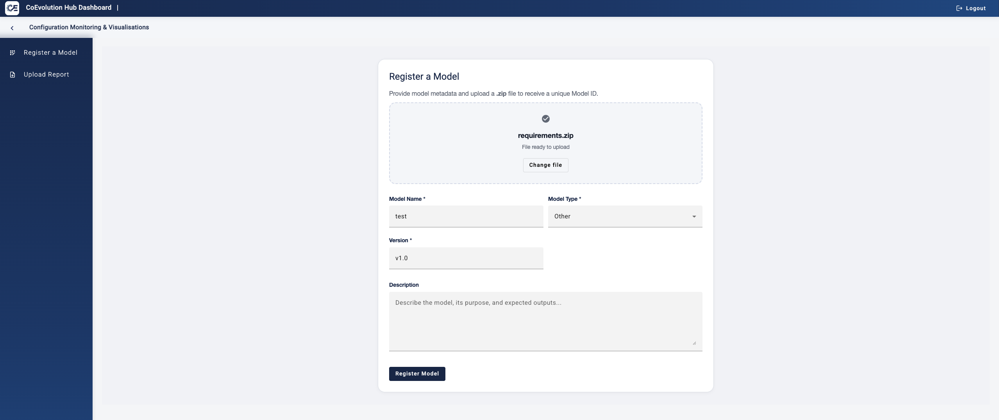
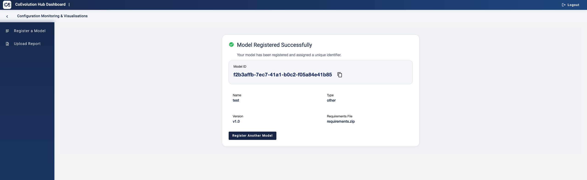

# CoEvolution Hub Dashboard

---

## Overview

The **CoEvolution Hub Dashboard** is the main user interface of the platform, providing access to core functionalities for managing AI models and interacting with the CoEvolution ecosystem.

This document focuses on the **currently implemented functionality**, namely:

- Model Registration

Other functionalities are included as placeholders and will be documented as they become available.

---

## Table of Contents

- [Overview](#overview)
- [Current Functionality](#current-functionality)
  - [Register a Model](#register-a-model)
- [User Flow](#user-flow)
- [Placeholders for Future Functionalities](#placeholders-for-future-functionalities)
- [Summary](#summary)

---

## Current Functionality

---

### Register a Model

#### Description

The **Register a Model** functionality allows users to onboard a new AI model into the CoEvolution platform by providing basic metadata and uploading a requirements file.

This is the **entry point of the model lifecycle**, enabling further processes such as assessment, monitoring, and AIMBOM generation.

---

### Step 1 — Access the Registration Screen

From the sidebar, select:

> **Register a Model**

The user is presented with a form to input model details and upload a file.



*Figure 1: Model registration form where users upload requirements and define metadata.*

---

### Step 2 — Upload Requirements File

Upload a `.zip` file containing:

- Model dependencies  
- Configuration files  
- Environment setup (e.g., `requirements.txt`)  

Supported interaction:

- Drag & drop  
- File browser selection  

---

### Step 3 — Fill in Model Metadata

**Required fields:**

| Field        | Description                     |
|--------------|---------------------------------|
| Model Name   | Name of the model              |
| Model Type   | Select from available options  |
| Version      | Model version (e.g., `v1.0`)   |

**Optional fields:**

| Field        | Description                     |
|--------------|---------------------------------|
| Description  | Short explanation of the model |

---

### Step 4 — Submit the Model

Click:

> **Register Model**

System actions:

- Sends request to backend  
- Stores uploaded file  
- Generates a unique Model ID  

---

### Step 5 — Registration Confirmation



*Figure 2: Confirmation screen displaying the generated Model ID and submitted metadata.*

Upon successful registration, a confirmation screen is displayed.

**Displayed information:**

- Model ID (UUID) → unique identifier  
- Model Name  
- Model Type  
- Version  
- Uploaded file name  

**User actions:**

- Copy Model ID  
- Register another model  

---

## User Flow

```text
       Open Dashboard
             ↓
       Register a Model
             ↓
Upload file + fill metadata
             ↓
          Submit
             ↓
      Receive Model ID
```

---

## Placeholders for Future Functionalities

The following sections are reserved for upcoming features:

### Upload Report  
(To be implemented)

### Model Monitoring  
(To be implemented)

### Risk Assessment & Recommendations  
(To be implemented)

### AIMBOM Management  
(To be implemented)

---

## Summary

The Model Registration functionality provides a simple and structured way to:

- Onboard AI models  
- Assign unique identifiers  
- Prepare models for integration into the CoEvolution pipeline  

This serves as the foundation for all subsequent operations within the platform.
